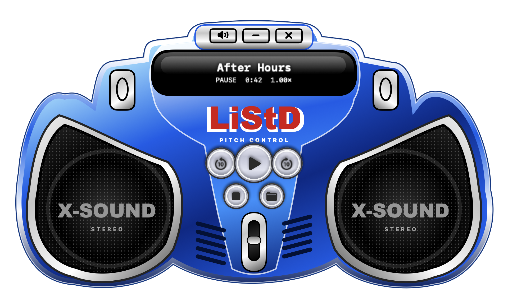
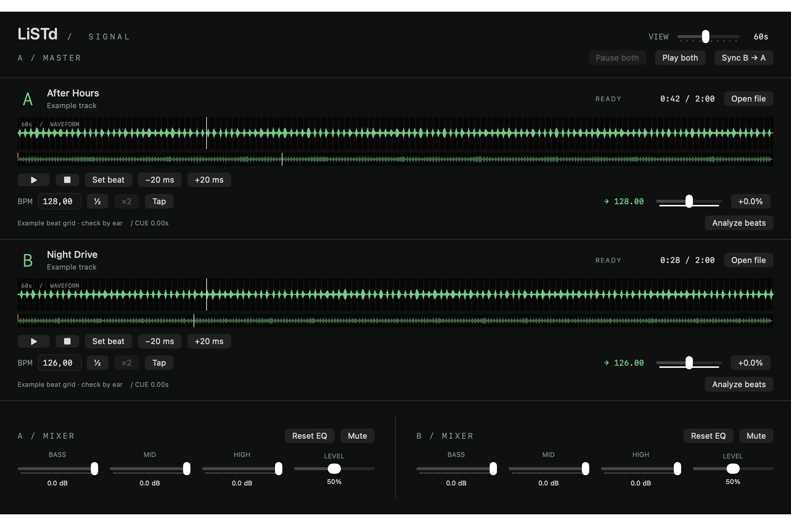

<div align="center">

# LiStD

The current source is LiStD 1.5. The existing public download remains the previously
published 1.4.1 build, named LiSTd; this source update does not replace that release.

### From tracklist to record collection.

A native Mac app for collecting, organizing and auditioning music for your next set.

**macOS 14+ · Apple Silicon & Intel · MIT licensed**

[**Download for Mac**](https://github.com/tikkbene-commits/LiSTd/releases/latest/download/LiSTd-Mac.zip) · [Installation guide](INSTALL.md) · [User guide](CRATE.md) · [Report a bug](https://github.com/tikkbene-commits/LiSTd/issues)



<sub>Amped · Blue / Red — one of five built-in skins. Interface previews use generated example audio.</sub>

</div>

---

## What it does

Drop in a DJ-set tracklist, check its artist/title order and choose your quality.
LiStD searches through Soulseek, verifies downloaded files and organizes accepted
tracks into folders you can browse and play inside the app.

| Collect | Organize | Listen |
| --- | --- | --- |
| Import CSV or text tracklists | Group tracks by genre and vibe | Play local files without importing them |
| Start at 320 kbps or lossless | Correct labels yourself | Change tempo and pitch like a turntable |
| Reuse qualifying local tracks | Move accepted files instead of copying them | Audition two tracks in Signal |
| Review uncertain matches and retry unfinished tracks | Open the resulting folders in Finder | Compare waveforms, cut EQ and align beats |

## Requirements

No Python, Homebrew, separate Sockseek app or Rosetta installation is needed to
**use the download**. Everything it needs is bundled. A Soulseek account and an
internet connection are needed for searches and downloads; local playback works
without signing in. No music or accounts are included.

[Sockseek](https://github.com/fiso64/sockseek) is the Soulseek command-line downloader
used by LiStD. The Mac ZIP **includes Sockseek 3.0.6**. Install it separately only
for a source build or standalone CLI use:

<details>
<summary><strong>Install Sockseek separately — source builds / CLI only</strong></summary>

1. Download the tested **3.0.6** Mac archive for your chip:
   [Apple Silicon](https://github.com/fiso64/sockseek/releases/download/v3.0.6/sockseek_3.0.6_osx-arm64.tar.gz)
   or [Intel](https://github.com/fiso64/sockseek/releases/download/v3.0.6/sockseek_3.0.6_osx-x64.tar.gz).
   The [official releases page](https://github.com/fiso64/sockseek/releases) lists other versions;
   newer upstream versions have not been validated with LiStD.
2. Extract the archive and, in Terminal, change into the extracted folder containing
   `sockseek` and `LICENSE`. For example, on Apple Silicon:

   ```sh
   cd ~/Downloads/sockseek_3.0.6_osx-arm64
   ```

   On Intel, use the extracted `sockseek_3.0.6_osx-x64` folder instead.
3. From that folder, install the executable with this one line:

   ```sh
   sudo mkdir -p /usr/local/bin && sudo install -m 755 ./sockseek /usr/local/bin/sockseek
   ```

4. Check that Terminal can find it:

   ```sh
   command -v sockseek
   sockseek --version
   ```

If you already have another Sockseek installation, check the path printed above;
LiStD's development app searches `/opt/homebrew/bin` before `/usr/local/bin`.
The GUI handles account sign-in through Keychain. Standalone CLI use has its own
configuration described in the [official Sockseek Quick Start](https://github.com/fiso64/sockseek#quick-start).
Installing the executable does not start a download or configure an account.

</details>

## Install in a few steps

1. **[Download LiStD-Mac.zip](https://github.com/tikkbene-commits/LiSTd/releases/latest/download/LiSTd-Mac.zip)**
   from Releases. Choose the Mac ZIP, not GitHub’s **Source code** archives or **Code → Download ZIP**.
2. Double-click the ZIP, open the **LiStD** folder and drag **LiStD.app** to **Applications**.
3. Open LiStD. This build is **not Apple-notarized**: if macOS blocks an unverified
   developer, try opening it once, then go to **System Settings → Privacy & Security → Open Anyway**
   for LiStD and confirm **Open**. Keep macOS security protections enabled.
4. Sign in with your own Soulseek account, or choose **Later** to play local files first.
   Close other Soulseek clients using the same account before signing in or downloading.

One universal download supports **Intel and Apple Silicon Macs running macOS 14 or newer**.
Windows, Linux and older macOS releases are not supported. Managed Macs may block
the first-open approval. See the [full installation guide and troubleshooting](INSTALL.md).

## Your first tracklist

Click **New import**, drop a `.csv` or `.txt` file, or paste your tracklist.
For plain text, explicitly select the correct artist/title order. This example uses
**Title - Artist**:

```text
0:00:00 After Hours - Example Artist
0:04:20 Night Drive - Another Artist
```

For CSV, use named columns. `Length` here is the **full track duration in seconds**:

```csv
Artist,Title,Length
Example Artist,After Hours,260
Another Artist,Night Drive,315
```

Text timestamps and CSV `SetStart` values are positions in a mix, not track lengths.
Original CSV fields are preserved. A [sample set tracklist](tracklists/YouTube%20set%20bNSesW8h94I.csv)
is also included in the repository.

**Importing with automatic downloads enabled starts downloads.** Turn that option
off to inspect the queue first. Keep the default **320 kbps or lossless**, or choose
your own threshold. LiStD checks artist/title evidence, supplied duration, measured
bitrate and full-file decoding before accepting a file. Uncertain files stay in
staging for review; alternate mixes and lower quality are not silently substituted.

Watch progress per track, then use **New arrivals** to open the folders that received
music. Use **Review file** to listen to an uncertain match, correct the expected
artist/title and recheck it. **Retry unfinished** searches again for remaining tracks.

The collection defaults to **All tracks**, with folder, import/tracklist, genre and
artist views plus title/artist/BPM/date sorting. Search applies within the selected
view. Drag the dividers to resize collection, player and the nonmodal import drawer.
**New import** opens the drawer; collapsing it keeps playback and progress.
Missing tracks offer individual or batch **Deep search**, with bounded fallback
queries and ambiguous candidates held for review. Original import fields and all
quality/verification checks remain in effect.

## Five ways to listen

| Skin | Feel |
| --- | --- |
| **Amped · Blue / Red** | A blue boombox, chrome controls, pitch fader and live LED spectrum |
| **Signal · Dual Deck** | Two decks, stacked waveforms, beat cues, tempo/phase sync and three-band cut EQ |
| **Silverwave** | Silver and purple, with a classic media-player feel |
| **LiStD · Original** | The straightforward native macOS workspace |
| **Cyber · Lilac** | A sculpted lilac player with a volume ring, live spectrum screen and a transport ring that steps through your collection |

Switch with the **Skin** menu. Your library and imports stay available across skins.
Playback supports play/pause, stop, seeking, volume and **0.5×–1.5× speed**. Speed also
changes pitch; there is no key lock.



In **Signal**, load files with the library’s **A/B** buttons, a deck’s **Open file**
button, or a drop onto its waveform. Tracks load paused. Analyze beats, check them
by ear, and correct **BPM**, **½ / ×2**, **Tap** or **Set beat** when needed.
**Sync A to B** changes A to match B’s effective tempo and beat phase;
**Sync B to A** changes B to match A. The second deck remains unchanged; **Play both** schedules
both decks together. Each deck has its own bass, mid, high, level and mute controls.

## What the estimates mean

- **Genre comes from file tags or your corrections.** Missing or ambiguous genres
  remain **Unsorted**. LiStD does not infer genre with a trained audio model.
- **Vibe is a tempo/density estimate:** Warm-Up, Groove, Driving, Peak Time or Needs Review.
  BPM can be wrong or half/double tempo. Labels are a starting point for listening.
- **Beat sync uses a fixed tempo and one-time alignment.** It can drift on live drums.
  There is no continuous lock, downbeat/phrase detection, headphone cue routing,
  recording or export. Tempo and beat-cue corrections last for the session.
- **Track matching uses metadata and filename evidence, not audio fingerprinting.**
  A YouTube tracklist can be imported, but LiStD does not identify songs from the mix
  audio or download the YouTube video.
- **Availability depends on peers.** A search result may be offline or unavailable;
  a download cannot be guaranteed.

## Your music and account

The installed app uses **`~/Music/LiSTd/`** for downloads and import history. Accepted
tracks go to `downloads/organized/<genre>/<vibe>/` within that folder. Accepted files
are moved into place; playing a local file does not move it or rewrite its tags.
Files awaiting review stay in `downloads/.incoming/`.

Audio analysis runs locally. Soulseek receives authentication and artist/title
searches. Your account is stored in **macOS Keychain**; the downloader uses a private
temporary configuration file while connecting. Signing out keeps your music and
history. [More about storage, verification and credentials →](CRATE.md#files-and-credentials)

The first beat analysis after an update can take longer while its local cache builds.
Keep `.music-sorter/catalog.json` inside your LiStD data folder: it holds manual
labels and move-recovery history. Back up the data folder before manually moving
organized music. The [command-line organizer](MUSIC_SORTER.md) includes move previews
and undo commands.

## Build from source

<details>
<summary><strong>For developers — regular installation uses the Mac download above</strong></summary>

The current universal build workflow uses an **Apple Silicon Mac**, Apple’s
command-line developer tools, and their `/usr/bin/python3`. The build creates an
isolated Python environment with the pinned audio dependencies. For development
analysis/imports, install `ffmpeg` and `ffprobe` on your PATH separately, and follow
the [Sockseek installation instructions above](#requirements).
Keep the pinned numerical versions; the previous NumPy 2 runtime caused beat-analysis crashes.

```sh
git clone https://github.com/tikkbene-commits/LiSTd.git
cd LiSTd
./build-crate
open LiStD.app
```

Keep this development app beside its source. It uses the checkout as its workspace.
The standalone download instead uses bundled tools and `~/Music/LiSTd/`.
Local playback and interface work do not require a Soulseek account.

Run the Python regression suite with generated fixtures and temporary folders:

```sh
.music-sorter/audio-env/bin/python -m unittest discover -s tests -v
```

Native playback, spectrum, sync and skin-render checks are documented in [CRATE.md](CRATE.md#build-and-checks).
Build a standalone universal ZIP with `./package-crate`; that workflow also requires
Rosetta on the Apple Silicon **build machine**. Recipient Macs run their native slice.
See [SHARING.md](SHARING.md) for packaging, signing and notarization, and
[STANDALONE_QA.md](STANDALONE_QA.md) for exactly what was tested.

The interface previews are rendered from the real SwiftUI player views with generated
example audio. To regenerate them without accessing a personal library or account:

```sh
mkdir -p .music-sorter/build
swiftc -O -parse-as-library native/CrateSkin.swift native/CratePlayer.swift native/BoomboxSkin.swift native/AudioSpectrum.swift native/TechnicalSkin.swift scripts/render_readme.swift -o .music-sorter/build/render-readme
.music-sorter/build/render-readme docs/images
```

For project maintenance, read [AGENTS.md](AGENTS.md) and [APP_CONTEXT.md](APP_CONTEXT.md)
before editing. Application source filenames still use the former name **Crate**.
Music, credentials, environments, generated bundles and personal state are excluded
from Git.

</details>

## Help and feedback

[Open an issue](https://github.com/tikkbene-commits/LiSTd/issues) with your macOS version,
Mac chip, LiStD version, the steps you took and the error message. Remove passwords,
account configuration and personal file paths from any logs or screenshots you attach.
Check the [installation troubleshooting](INSTALL.md#troubleshooting) first.

## License and credits

LiStD’s original code is available under the **[MIT license](LICENSE)**.
It is built with SwiftUI, AVFoundation, Accelerate, Python and librosa, with
Soulseek transfers provided by Sockseek and audio inspection provided by FFmpeg.
Bundled components retain their own licenses; see [THIRD_PARTY.md](THIRD_PARTY.md)
and the notices and source archives included in the app’s Resources folder.

[Release notes](https://github.com/tikkbene-commits/LiSTd/releases) · [Full changelog](CHANGELOG.md)
